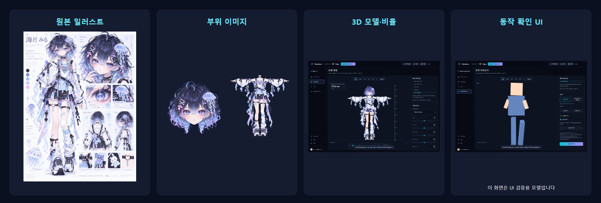
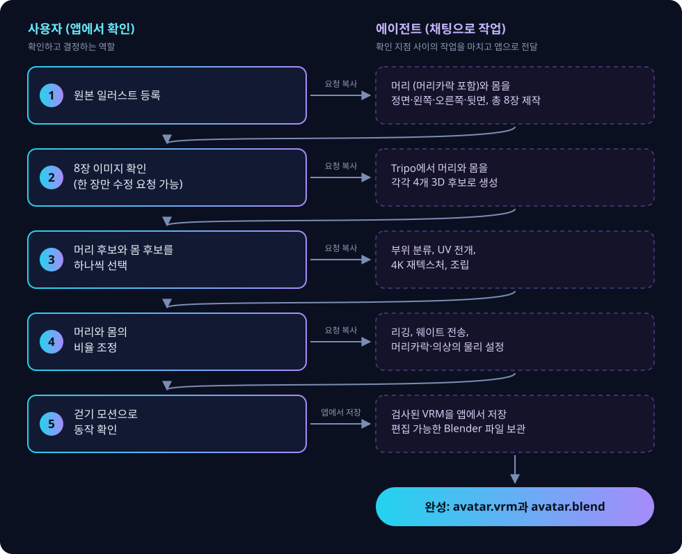
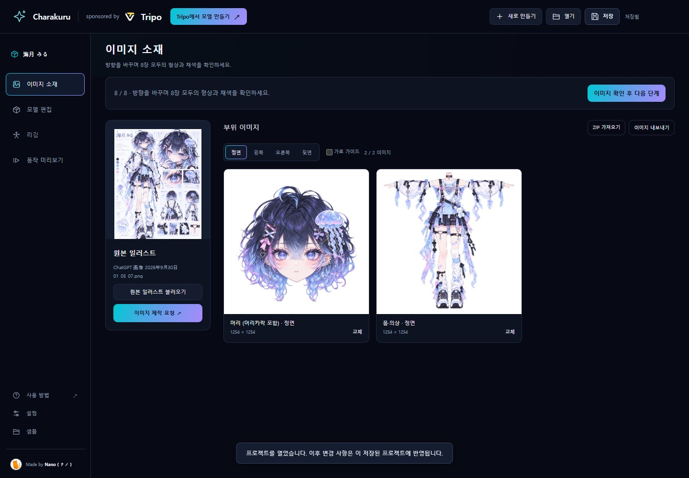
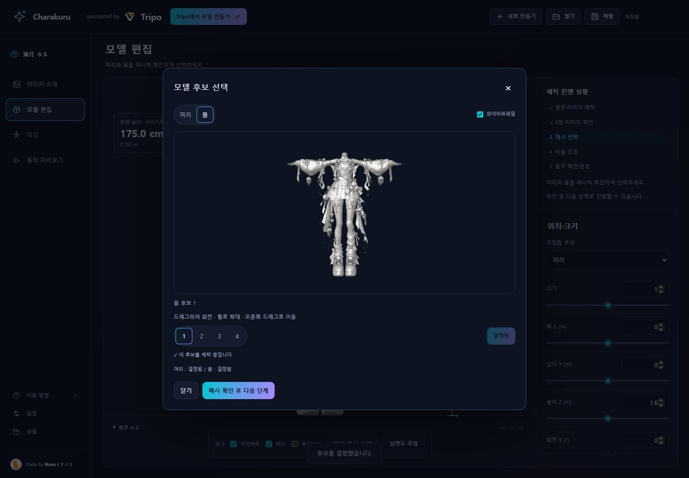
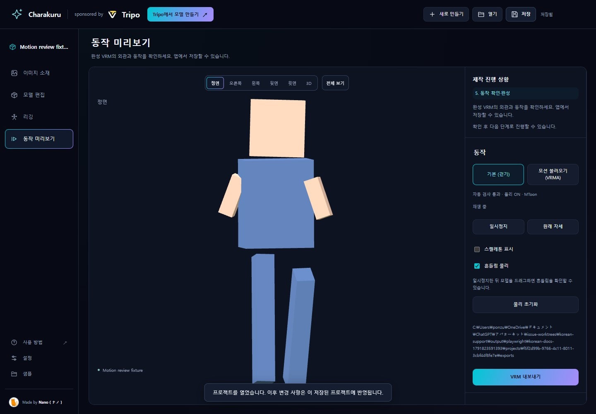
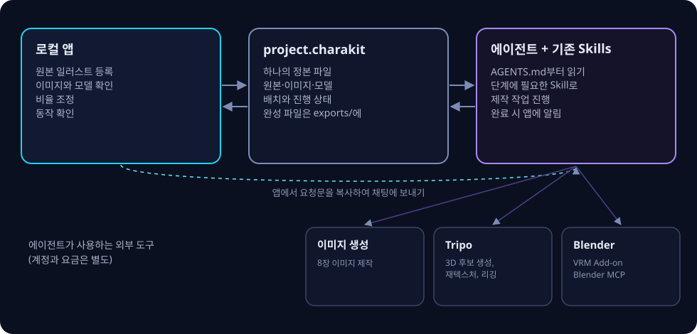

<p align="center"></p>

<h1 align="center">Charakuru / きゃらくる</h1>

<p align="center">캐릭터 일러스트 한 장으로 AI 에이전트와 역할을 나누어 VRM 아바타를 만드는 키트입니다.</p>

<p align="center"><a href="README.md">English</a> · <a href="README.ja.md">日本語</a> · <a href="docs/tutorial.ko.md"><b>튜토리얼</b></a> · <a href="https://github.com/nanocle/Charakuru/releases">다운로드 (Releases)</a> · <a href="docs/license.ko.md">이용 조건</a></p>

<p align="center">   </p>

## Charakuru란?

Tripo의 Smart Mesh를 활용하는 캐릭터 모델링 지원 키트입니다. Nano가 고안한 제작 흐름을 로컬 앱과 에이전트용 Skills에 담아 사용자가 재현할 수 있도록 제공합니다. Tripo 조작, Blender 조작, 리깅 등 복잡한 작업을 GPT-6.1 Sol이나 GPT-6 Astra에 맡길 수 있습니다.

사용자는 원본 등록과 외관 확인 등의 판단을 담당합니다. 직접 Blender를 다루는 대신 로컬 앱의 버튼으로 진행합니다. 전신이 보이는 일러스트 한 장으로 제작을 시작할 수 있습니다. 어려운 부분이나 개선 의견은 Issues에 알려 주세요.

> [!WARNING]
> **이 키트는 개발 중입니다.** 문서가 충분하지 않은 부분, 오류, 아직 없는 기능이 있습니다.
>
> **이 설명은 AI가 작성했습니다.** Codex나 Claude Code에서 이 저장소 또는 압축을 푼 키트 폴더를 열어 에이전트와 대화하며 이해하는 것을 권장합니다.
>
> 예: ‘README.ko.md와 AGENTS.md를 읽고 이 키트로 무엇을 할 수 있는지 한국어로 설명해 주세요.’

<p align="center"></p>
<p align="center"><sub>예시 캐릭터: 海月 みる. 원본 → 부위 이미지 → 3D 모델. 동작 확인 화면은 별도의 UI 검증용 모델입니다.</sub></p>

## 제작은 어떻게 진행되나요?

**앱에서 확인**하고 **채팅으로 요청**하는 과정을 다섯 확인 지점에 따라 진행합니다.

<p align="center"></p>

1. 앱에서 확인한 뒤 다음 단계 버튼을 눌러 **요청문을 복사**합니다.
2. Codex 채팅에 붙여 넣어 보냅니다.
3. 작업이 끝나면 앱이 최신 상태를 불러오고 다음 확인 지점에서 멈춥니다.

일반 제작에서는 파일을 매번 내보내거나 다시 불러올 필요가 없습니다. 후보 결정은 사용자가 합니다. 모델 후보는 비교 창에서 회전하여 확인하고 모델 편집의 **모델 후보 선택**으로 다시 열 수 있습니다. 삼면도의 크기와 발 높이는 세 방향에 함께 적용됩니다. 텍스처 제작 후 다른 후보를 채택하면 원래 프로젝트를 유지하며 복사본으로 분기합니다. 완성 VRM은 동작 확인 화면에서 저장합니다.

<table><tr><td width="33%"></td><td width="33%"></td><td width="33%"></td></tr><tr><td><b>이미지 확인</b><br>머리와 몸을 네 방향씩 확인하고 한 장만 수정할 수도 있습니다.</td><td><b>3D 후보 선택</b><br>머리와 몸 각각 네 후보를 비교합니다.</td><td><b>동작 확인</b><br>걷기로 어깨와 무릎 등의 변형을 확인합니다.</td></tr></table>

## 설계 원칙

<p align="center"></p>

- **판단은 사용자, 작업은 에이전트가 합니다.** 원본 등록, 이미지 확인, 후보 결정, 비율 조정, 동작 확인을 담당하세요. 그 사이의 분리·분류·내보내기·등록은 에이전트가 진행합니다.
- **확인 지점에서 멈춥니다.** 외관과 후보를 에이전트가 임의로 결정하지 않습니다.
- **프로젝트는 하나의 정본에 저장합니다.** `project.charakit`을 같은 경로에서 업데이트합니다. 같은 폴더에서 앱을 다시 시작하면 이어서 작업할 수 있습니다. 다른 후보를 채택해 분기하는 경우에는 원본을 보존합니다.
- **앱은 컴퓨터에서 실행합니다.** 일반 실행에 `npm install`은 필요하지 않습니다. 이미지 생성과 Tripo는 사용자 계정으로 이용합니다.

## 필요한 환경

| 항목 | 용도 |
| --- | --- |
| Node.js 22 이상 | 앱 실행 |
| 데스크톱 Chromium 계열 브라우저 (Chrome 등) | 앱과 Tripo 조작 |
| 이미지 생성·브라우저 조작이 가능한 Codex | 이미지 제작, Tripo와 Blender 작업 |
| Tripo 계정과 로그인된 브라우저 | 3D 후보, 재텍스처, 리깅 |
| Blender 5.2, VRM Add-on for Blender, Blender MCP | 웨이트, 흔들리는 부위, VRM 내보내기 |
| 사용할 권리가 있는 원본 일러스트 | PNG / JPEG / WebP, 최대 20 MB |

외부 서비스의 이용 조건, 요금, 크레딧은 각 서비스에 따릅니다. 에이전트가 시작할 때 부족한 환경을 확인합니다.

## 시작하기

이 저장소에는 배포용 문서와 이미지가 포함되어 있습니다. 실행 가능한 앱과 루트 `AGENTS.md`는 전용 배포 ZIP에 들어 있습니다.

1. [Releases](https://github.com/nanocle/Charakuru/releases)에서 전용 `charakuru-1.0.4-….zip`을 다운로드하여 쓰기 가능한 폴더에 풉니다. GitHub의 자동 생성 ‘Source code’ ZIP과 구분하세요.
2. Codex에서 폴더를 열고 다음처럼 요청합니다.

   ```text
   루트 AGENTS.md를 읽고 이 키트로 캐릭터 제작을 시작하도록 도와주세요. 한국어로 안내해 주세요.
   ```

3. 에이전트가 앱을 시작하면 표시된 `http://127.0.0.1:8766`을 브라우저에서 엽니다.
4. 왼쪽 아래 **Settings → Language**에서 **한국어**를 선택합니다. 이후 같은 브라우저에서 설정을 복원합니다.

직접 실행하려면 압축을 푼 폴더에서 `npm start`를 실행하세요. 자세한 과정은 [튜토리얼](docs/tutorial.ko.md)을 참조하세요. 한국어 UI에서 복사한 요청문은 한국어로 작성되며, 실행 명령과 파일 경로는 원문을 유지합니다.

시작 명령은 `begin`을 사용합니다. Windows Codex에서 오래된 `start` 요청이 `blocked by policy`로 거부되면 [복구 절차](docs/tutorial.ko.md#windows-codex에서-시작-명령이-거부되는-경우)를 확인하고 새 앱에서 요청문을 다시 복사하세요.

## 키트 구성

| 항목 | 내용 |
| --- | --- |
| `AGENTS.md` | 에이전트가 먼저 읽는 환경·단계·저장 규칙 |
| `public/`, `server.mjs` | 로컬 확인 앱 |
| `skills/` | 제작 과정에 사용하는 9개의 Skills |
| `scripts/` | 에이전트의 프로젝트 업데이트 도구 |
| `assets/donor/weighted-body.blend` | 웨이트 전송용 기본 모델 |
| `docs/` | 튜토리얼, 동작 확인, 일본어·영어·한국어 이용 조건 해설 |

<details><summary>9개의 Skills</summary>

| Skill | 역할 |
| --- | --- |
| `charakit-project` | 프로젝트 검사·불러오기·업데이트 |
| `character-parts-images` | 머리와 몸의 네 방향, 총 8장 제작 |
| `character-three-views` | 비율 조정을 위한 전신 삼면도 제작 |
| `character-material-brushup` | 형상·디자인을 보존하며 채색·질감 마무리 |
| `tripo-agent-workflow` | 후보 생성, 분류, UV·텍스처, 리깅 |
| `tripo-studio-download` | Tripo Studio에서 내보낸 모델 수신과 저장 파일 확인 |
| `avatar-weight-transfer` | 흔들리는 부위 분리와 웨이트 전송 |
| `avatar-spring-setup` | 흔들림 설정과 VRM 내보내기·확인 |
| `tripo-character-setup` | 사용자가 마커 경로를 선택한 경우의 고급 리깅 |

</details>

## 현재 제한

- 요청문은 복사한 뒤 채팅에 보내야 합니다. 작업 중에는 앱을 열어 두세요.
- 새 캐릭터는 기본 표정과 고정된 시선으로 제작합니다. 표정 전환과 시선 움직임은 포함하지 않습니다.
- 동작 확인에는 구조·MToon·흔들림 자동 검사를 통과한 완성 VRM을 표시합니다. 걷기와 물리가 처음부터 켜집니다. 외관의 평가는 사용자가 합니다.
- **VRM 내보내기**로 확인 중인 VRM을 직접 저장합니다. VRM 내보내기에서 이름·작성자·이용 조건을 확인하고 정보를 저장하며 다운로드합니다.
- 다른 컴퓨터로 옮길 때는 `project.charakit`뿐 아니라 완성 VRM·Blend가 있는 제작 폴더를 함께 보관하세요.

## 이용 조건

비상업적·상업적 이용 모두 라이선스의 조건을 따라 사용할 수 있습니다. 키트 재배포 또는 키트 코드를 사용자에게 제공하는 제품·서비스에 통합하려면 사전에 Nano에게 문의하세요. 개인적인 수정과 복사는 허용됩니다. 동봉 소재만 추출하여 키트 외부로 가져가거나 따로 재배포해서는 안 됩니다. 법이 허용하는 범위에서 이용으로 발생한 손해에 대한 책임을 지지 않습니다.

사업 전체의 연매출과 누적 조달 자금이 **각각 1억 엔 미만**이면 표준 라이선스 조건에 따라 별도 계약이나 등록 없이 사용할 수 있습니다. **어느 하나라도 1억 엔 이상**이면 상업적·업무상 이용을 시작하거나 계속하기 전에 Nano를 창구로 권리자 등과 별도 서면 라이선스 계약을 체결해야 합니다. 매출과 조달 자금은 합산하지 않습니다. 기준 통화는 일본 엔(JPY)입니다.

연매출은 **가장 최근에 종료된 회계연도**로 판단합니다. 회계연도가 없으면 직전 12개월, 아직 첫 회계연도가 끝나지 않았으면 창업 이후의 실제 매출(최대 직전 12개월)을 사용합니다. 창업 후 12개월 미만 또는 짧은 첫 회계연도는 연환산하지 않습니다. 누적 조달 자금은 자금을 받을 때 재확인합니다. [이용 조건 해설](docs/license.ko.md)과 정본인 영문 [LICENSE](LICENSE)를 확인하세요.

## 문제 보고

실패한 단계와 개선 의견은 [보고 방법](CONTRIBUTING.md)에 따라 [Issues](https://github.com/nanocle/Charakuru/issues)에 알려 주세요. 한국어로도 보고할 수 있습니다. PR은 받지 않습니다.

---

<p align="center"><sub>Made by Nano（ナノ） · sponsored by Tripo</sub></p>
