# 튜토리얼: 첫 VRM 아바타 만들기

[README](../README.ko.md) · [English](tutorial.md) · [日本語](tutorial.ja.md)

> [!WARNING]
> **이 키트는 개발 중이며 이 설명은 AI가 작성했습니다.** 부족한 문서, 오류, 아직 없는 기능이 있습니다. Codex나 Claude Code에서 키트 폴더를 열어 ‘README.ko.md와 AGENTS.md를 읽고 무엇을 할 수 있는지 한국어로 설명해 주세요’라고 요청하며 진행할 수 있습니다.

원본 일러스트 한 장으로 VRM을 완성하는 순서를 설명합니다. 예시 캐릭터는 ‘海月 みる’입니다. **👤 사용자 조작**은 버튼과 외관 확인, **🤖 에이전트 작업**은 요청 후 진행되는 작업의 설명입니다.

<p align="center"></p>

## 목차

0. [준비](#0-준비)
1. [키트 시작](#1-키트-시작)
2. [원본 등록과 8장 이미지 요청](#2-원본-등록과-8장-이미지-요청)
3. [8장 이미지 확인](#3-8장-이미지-확인)
4. [머리와 몸의 3D 후보 선택](#4-머리와-몸의-3d-후보-선택)
5. [비율 조정](#5-비율-조정)
6. [완성 VRM 동작 확인](#6-완성-vrm-동작-확인)
7. [VRM 저장](#7-vrm-저장)

[저장과 재개](#저장과-재개) · [문제 해결](#문제-해결)

## 0. 준비

[README의 필요한 환경](../README.ko.md#필요한-환경)을 확인하세요. 부족한 항목은 시작 시 에이전트가 확인합니다.

- 원본 일러스트: 사용할 권리가 있는 PNG / JPEG / WebP, 최대 20 MB. 머리카락·의상·신발까지 전신이 보이는 그림이 적합합니다. 얼굴 확대나 뒷면이 있는 설정화도 사용할 수 있습니다.
- VRM 정보: 모델 이름, 작성자, 다른 사람의 사용·상업적 이용·재배포·수정 등의 조건을 준비하세요. 마지막에 앱에서 입력합니다.

## 1. 키트 시작

**👤 사용자 조작**

1. [Releases](https://github.com/nanocle/Charakuru/releases)에서 전용 `charakuru-1.1.0-….zip`을 다운로드하여 쓰기 가능한 폴더에 풉니다. ‘Source code’ ZIP과 구분하세요.
2. Codex에서 폴더를 열어 다음처럼 요청합니다.

   ```text
   루트 AGENTS.md를 읽고 이 키트로 캐릭터 제작을 시작하도록 도와주세요. 한국어로 안내해 주세요.
   ```

3. 앱이 시작되면 표시된 `http://127.0.0.1:8766`을 브라우저에서 엽니다.
4. 왼쪽 아래 **Settings → Language**에서 **한국어**를 선택합니다. 초기 표시는 영어이며 선택한 언어는 같은 브라우저에 저장됩니다.

**🤖 에이전트 작업**

`AGENTS.md`를 읽고 Node.js, 이미지 생성, 브라우저 조작, Blender 등이 가능한지 확인한 뒤 앱을 시작합니다. 앱과 Tripo는 사용자의 기존 브라우저와 탭을 우선합니다. 탭이 없으면 같은 브라우저에 추가하고 열린 브라우저가 없을 때만 새로 시작합니다. 연결이 필요하면 안내합니다.

<p align="center">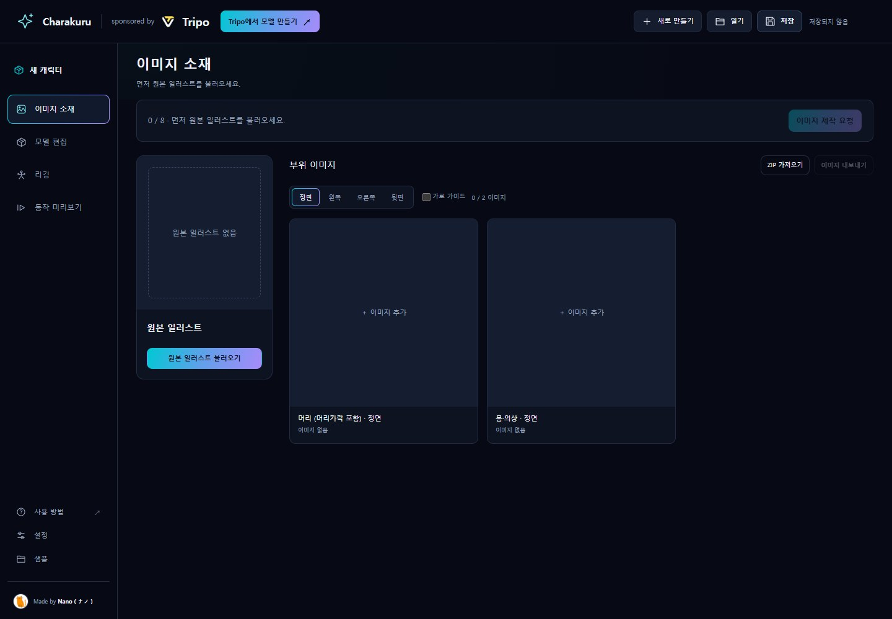</p>

왼쪽 메뉴는 **이미지 소재 → 모델 편집 → 리깅 → 동작 미리보기**입니다. 오른쪽 위 **새로 만들기·열기·저장**으로 프로젝트를 관리합니다. 직접 실행하려면 키트 폴더에서 `npm start`를 실행하세요. `npm install`은 필요하지 않습니다.

### 모든 단계의 공통 요청 방법

1. 다음 단계 버튼을 눌러 요청 창을 엽니다.
2. **요청문 복사**를 누릅니다.
3. Codex 채팅에 붙여 넣어 보냅니다. **복사만으로는 작업이 시작되지 않습니다.**
4. 앱을 열어 둡니다. 제목 아래에 진행 상황이 표시됩니다.
5. 작업이 끝나면 앱이 새 상태를 불러오고 확인을 기다립니다.

<p align="center">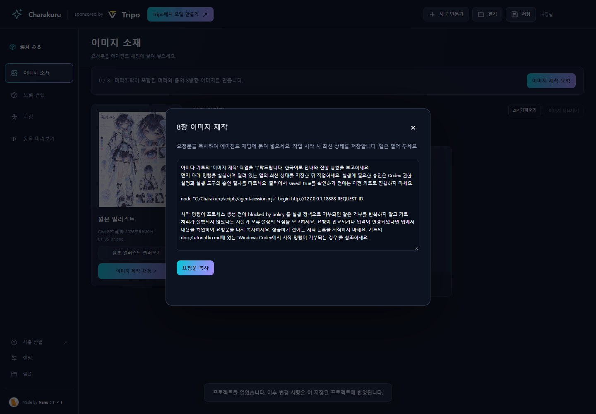</p>

한국어 UI에서 요청문은 한국어로 작성됩니다. `begin` 등의 실행 명령, 경로, ID는 그대로 전달하세요. 언어만 전환하면 같은 요청의 표시 문구가 바뀌며 새 요청을 만들지 않습니다.

## 2. 원본 등록과 8장 이미지 요청

**👤 사용자 조작**

1. **이미지 소재**를 열고 **원본 일러스트 불러오기**로 파일을 선택합니다.
2. **이미지 제작 요청**을 눌러 요청문을 복사하고 채팅에 보냅니다.

<p align="center">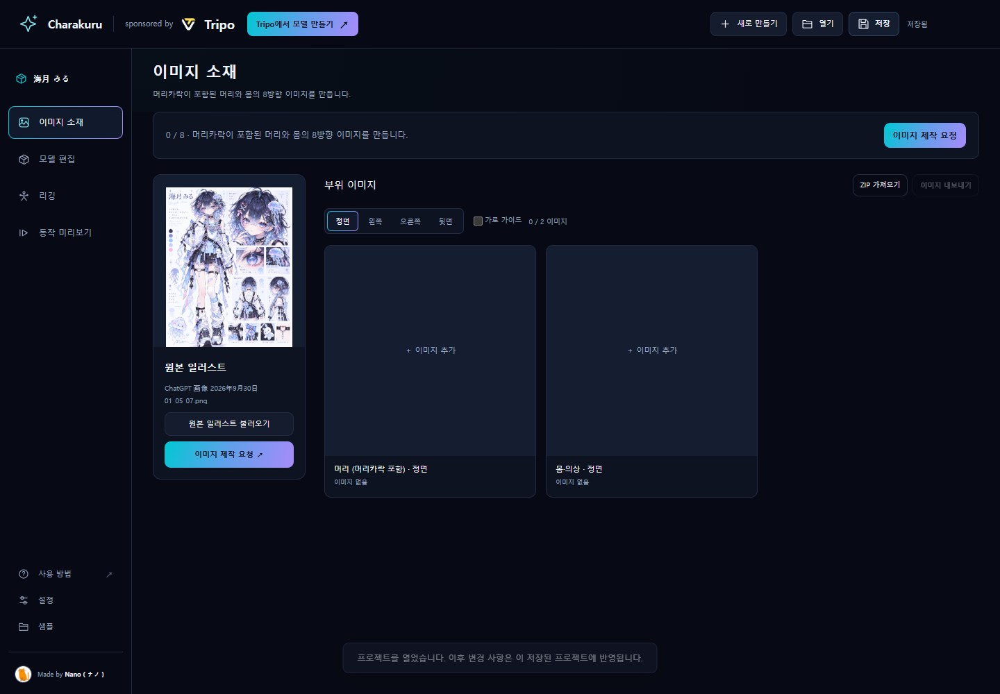</p>

**🤖 에이전트 작업**

원본 한 장을 디자인 기준으로 **머리(머리카락 포함)**와 **의상을 입은 몸**을 정면·왼쪽·오른쪽·뒷면으로 각각 제작합니다. 총 8장입니다. 원본과 완성 부위를 참조하여 균형 조정용 전신 정면·캐릭터의 오른쪽 측면·뒷면 삼면도도 같은 프로젝트에 등록합니다.

- 머리는 기울기를 바로잡고 입을 다문 편안한 표정으로 맞춥니다.
- 몸은 팔을 옆으로 벌린 T포즈로 만듭니다.
- 머리카락·피부·의상의 채색을 완성된 캐릭터 일러스트 수준으로 다듬습니다.
- 실제 생성 프롬프트와 함께 이미지를 등록합니다.

<p align="center">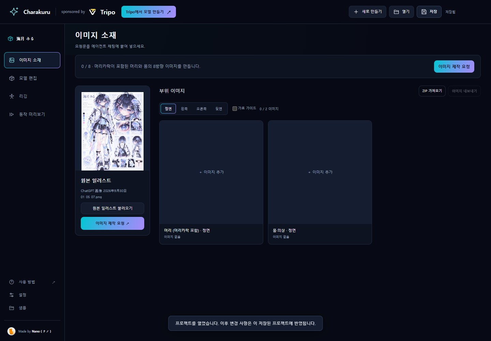</p>

## 3. 8장 이미지 확인

**👤 사용자 조작**

1. **정면·왼쪽·오른쪽·뒷면**을 전환하여 머리와 몸의 8장을 모두 확인합니다. 좌우는 캐릭터 기준입니다.
2. 머리카락 길이·장식, 의상 무늬·색, 좌우 비대칭 디자인이 원본과 일치하는지 확인합니다. 머리에 몸이 섞이거나 몸에 뒷머리가 남지 않았는지도 확인하세요.
3. 한 장을 수정하려면 클릭하여 확대하고 **선택한 이미지 수정**을 누릅니다. 요청문을 채팅에 붙여 넣고 **어디를 어떻게 바꿀지** 적어 보냅니다.
4. 문제가 없으면 **이미지 확인 후 다음 단계**로 진행하고 요청문을 보냅니다.

하단 삼면도도 확대하여 원본의 비율과 디자인이 유지되는지 확인할 수 있습니다.

<p align="center"></p>
<table><tr><td width="50%">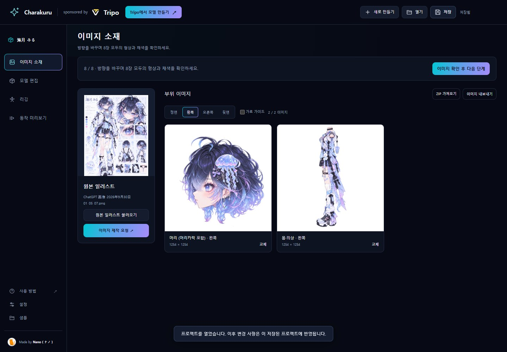</td><td width="50%">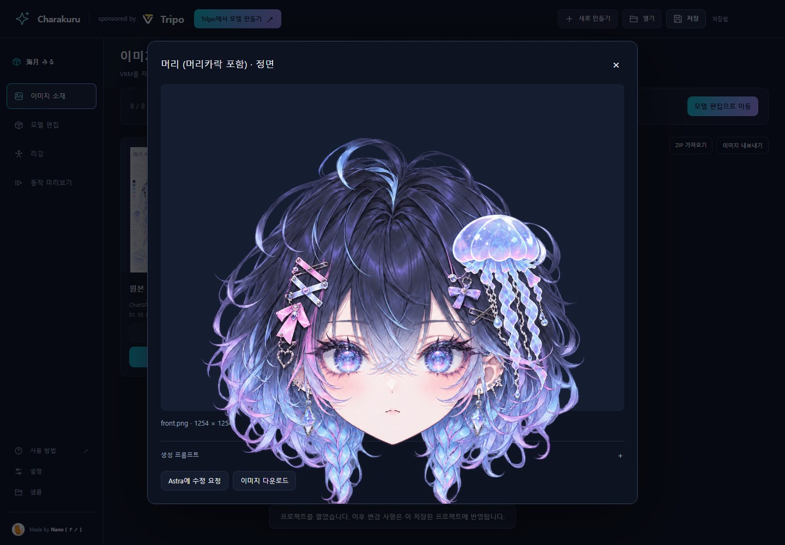</td></tr></table>

**🤖 에이전트 작업**

다음 요청으로 채택한 이미지에서 Tripo 3D 후보를 생성합니다. 머리와 몸 각각 4개, P2.0·사각면 25,000개입니다. 후보를 등록한 뒤 에이전트가 선택하지 않고 사용자 확인에서 멈춥니다.

## 4. 머리와 몸의 3D 후보 선택

**👤 사용자 조작**

1. 비교 창에서 **머리**와 **1~4**를 전환하여 확인합니다. 다시 열려면 모델 편집의 **모델 후보 선택**을 누릅니다. 비교 중에는 삼면도를 표시하지 않습니다.
2. 드래그로 회전하고 정면·오른쪽·왼쪽·뒷면·윗면·3D로 방향을 바꿉니다. **와이어프레임**으로 면을 확인할 수 있습니다.
3. 원하는 후보를 표시한 상태에서 채택 버튼을 누릅니다.
4. **몸**도 하나 선택합니다. 양쪽을 결정한 뒤 메시 확인 버튼으로 다음 요청문을 보냅니다.

<table><tr><td width="50%">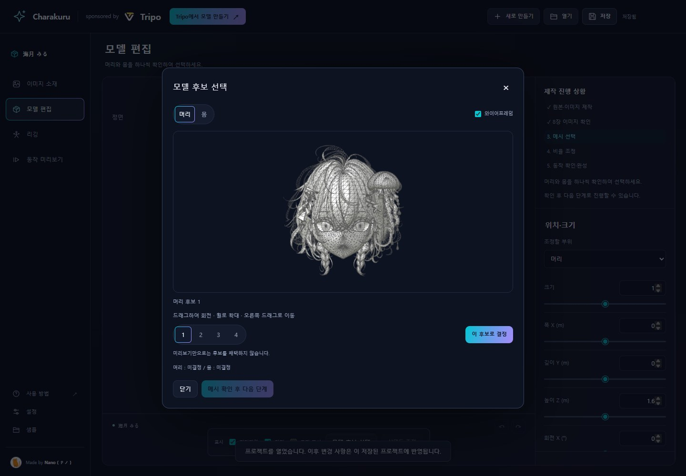</td><td width="50%"></td></tr></table>

**🤖 에이전트 작업**

채택된 모델을 분리·분류하고 부위별 UV와 텍스처를 준비합니다. 텍스처는 머리카락·머리·상체·하체·기타 액세서리의 5분류입니다. 하체는 허리 의상·치마나 바지·다리·신발을 함께 묶습니다. 흔들리는 부위는 별도로 분류합니다. 앞뒤 참조를 제작하여 Tripo에서 Smart UV와 부위별 4K 재텍스처를 진행하고 원래 형상·UV에 복원하여 조립합니다. 모든 필요한 재질에 MToon을 적용하며 텍스처·UV·투명도를 보존합니다.

<p align="center">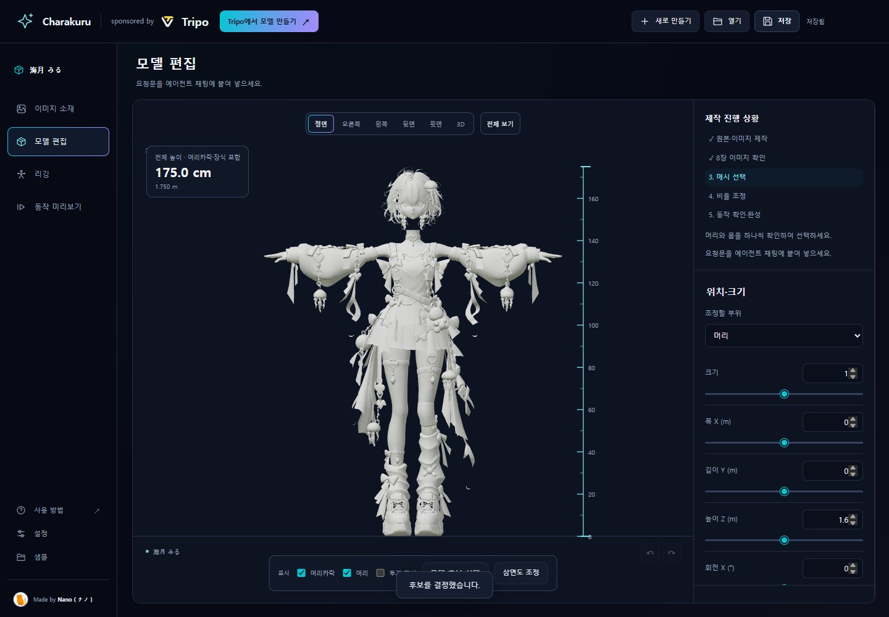</p>

텍스처 제작 후 다른 후보를 채택하면 현재 프로젝트를 보존하며 새 복사본으로 분기합니다. 복사본에서는 부위·텍스처·리그·흔들림 설정을 다시 진행합니다.

## 5. 비율 조정

**👤 사용자 조작**

1. **모델 편집 → 위치·크기**에서 머리와 몸을 조정합니다.
2. 조정할 부위를 선택하여 크기·위치를 맞춥니다. 머리와 머리카락을 함께 움직일 수 있습니다.
3. 정면과 오른쪽 측면에서 목 연결과 머리 크기를 확인합니다. 실행 취소·다시 실행으로 되돌릴 수 있습니다.
4. 필요한 경우 목표 전체 높이를 적용합니다. 높이는 머리카락·장식을 포함합니다.
5. **삼면도 조정**으로 이미지 크기·발 높이·좌우 위치·투명도를 맞춥니다. 크기와 발 높이는 세 방향에 함께 적용되고 좌우 위치는 방향별입니다.
6. 비율을 확인한 뒤 다음 단계 요청문을 보냅니다.

<table><tr><td width="50%">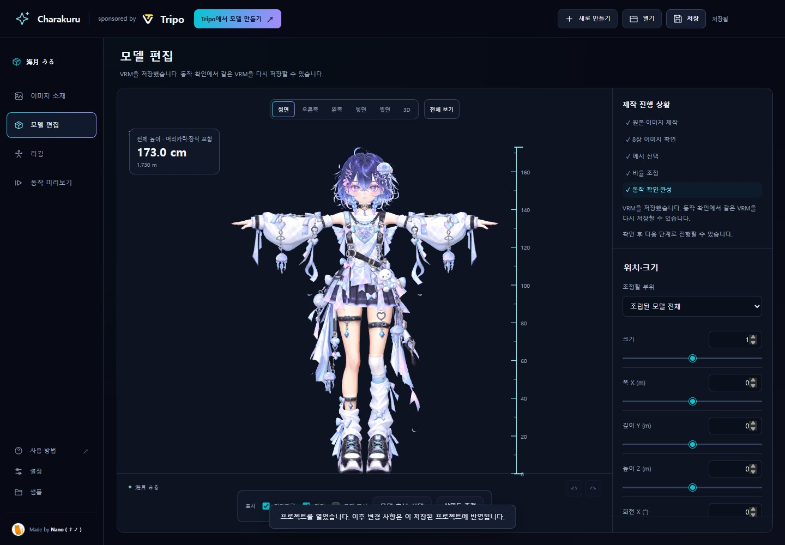</td><td width="50%">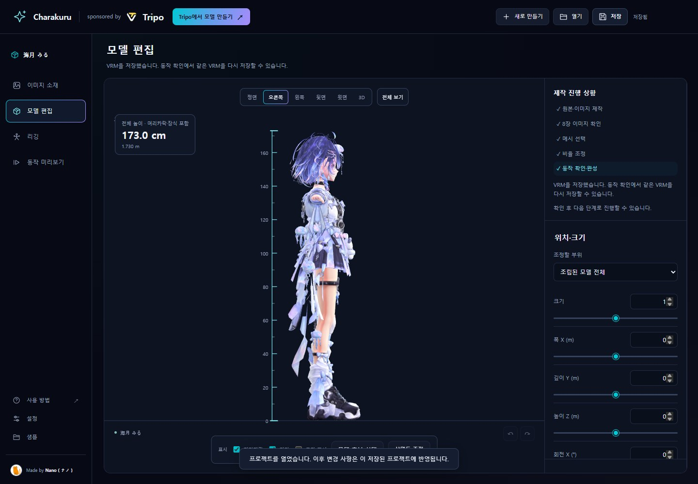</td></tr></table>

**🤖 에이전트 작업**

머리카락을 제외한 배치된 머리·몸을 Tripo에서 리깅하고 원래 크기로 보정한 본 배치만 가져옵니다. 원래 메시와 텍스처를 유지하며 기본 모델에서 웨이트를 전송합니다. 머리카락·의상의 흔들림 본·웨이트·충돌을 설정하고 동작 확인에서 멈춥니다.

## 6. 완성 VRM 동작 확인

앱은 저장된 Blend에서 완성 VRM을 만들고 구조·MToon·텍스처·부위별 물리 응답을 자동 검사합니다. 외관의 좋고 나쁨은 사용자가 판단합니다.

**👤 사용자 조작**

1. **동작 미리보기**에서 검사된 완성 VRM이 물리 ON·**기본 (걷기)**으로 재생됩니다. 모델 정보가 없어도 먼저 동작을 확인할 수 있습니다.
2. **일시정지**는 애니메이션을 멈춥니다. 모델을 잡아 움직이면 흔들림을 확인할 수 있습니다. 배경 드래그는 카메라 조작입니다.
3. **원래 자세**, **스켈레톤 표시**, **물리 초기화**를 사용할 수 있습니다. 물리 초기화는 위치·포즈를 유지합니다.
4. **모션 불러오기 (VRMA)**로 다른 모션을 선택합니다. 불러온 모션과 기본 걷기를 전환하고 **변경**으로 교체할 수 있습니다.
5. 정면과 측면에서 외관·동작을 확인하세요. 수정이 필요하면 채팅으로 요청합니다.

VRMA는 현재 화면에만 유지됩니다. 새로고침하면 기본 걷기로 돌아갑니다. 확인용 포즈·위치는 저장되는 VRM을 바꾸지 않습니다. 자세한 내용은 [동작 확인 가이드](preview-user.ko.md)를 참조하세요.

## 7. VRM 저장

**VRM 내보내기**로 모델 정보 창을 열어 이름·작성자·이용 조건을 확인하고 **정보 저장 후 내보내기**를 누릅니다. 형상·재질·흔들림은 확인한 상태를 유지하며 정보를 저장하고 다운로드합니다. 취소하면 동작 확인을 계속할 수 있습니다. 요청문 복사나 에이전트의 재내보내기는 필요하지 않습니다. 로컬판은 `exports/avatar.vrm`과 편집용 `exports/avatar.blend`도 저장합니다.

작성자와 이용 조건은 프로젝트에 저장하여 재사용합니다. 모델·흔들림 설정을 변경하면 새 VRM을 검사한 뒤 표시합니다.

## 저장과 재개

- 에이전트의 시작 명령이 앱의 최신 상태를 자동 저장합니다. 다른 시점에 저장하려면 오른쪽 위 **저장**을 누릅니다.
- 같은 폴더에서 앱을 다시 시작하면 이전 프로젝트가 열립니다.
- **설정**에서 저장 위치를 확인하고 **이동용 복사본 내보내기**를 사용할 수 있습니다.
- 이전 단계를 보는 것만으로 작업을 초기화하지 않습니다. 이미지·후보·배치를 바꾸면 후속 단계를 다시 진행합니다.
- 다른 컴퓨터로 옮길 때는 `project.charakit`과 `exports` 등을 포함한 제작 폴더를 함께 보관합니다.
- 언어·테마는 브라우저 설정입니다. 프로젝트명·소재명·메모·생성 프롬프트는 언어를 전환해도 유지됩니다.

<p align="center">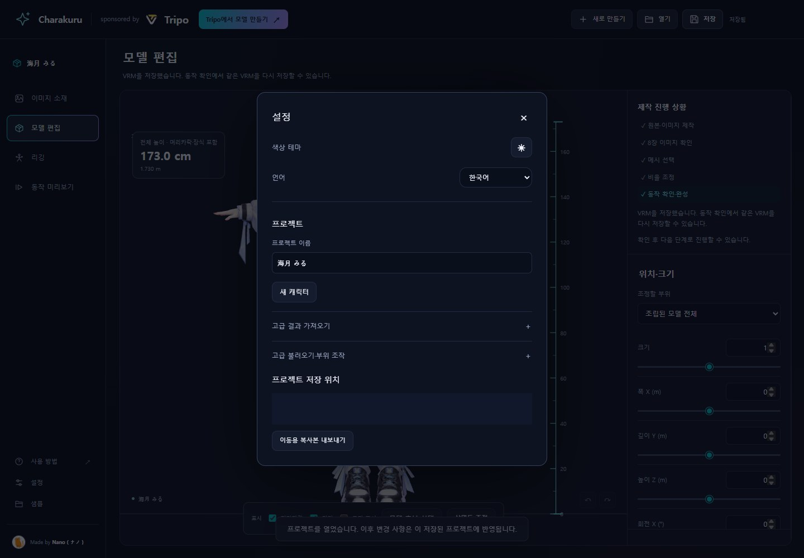</p>

## 문제 해결

### Windows Codex에서 시작 명령이 거부되는 경우

오래된 `agent-session.mjs start URL REQUEST_ID` 요청이 `blocked by policy`로 거부되면 업데이트된 앱에서 요청문을 다시 복사하세요. 새 요청은 `agent-session.mjs begin`을 사용합니다.

1. 앱에서 원본과 프로젝트를 확인합니다.
2. 요청문을 다시 복사하여 채팅에 보내고 앱은 열어 둡니다.
3. 에이전트가 시작 명령 성공과 `saved: true`를 확인한 뒤 최신 정본으로 진행합니다.

요청이 만료되거나 입력이 바뀌면 다시 확인하여 요청문을 복사하세요. 수동 저장이나 이름이 다른 키트를 만들 필요는 없습니다. `begin`도 프로세스 생성 전에 거부되면 시작 처리는 실행되지 않은 것입니다. 같은 거부를 반복하거나 스크립트를 수정하여 우회하지 마세요. 키트·Windows·Codex 버전, 권한 설정, 개인 경로를 제외한 오류 요점을 보고합니다. 기존 [Issue #2](https://github.com/nanocle/Charakuru/issues/2)와 [Issue #3](https://github.com/nanocle/Charakuru/issues/3)도 참조할 수 있습니다.

### 기타 문제

- 요청 후 아무 일도 없으면 채팅에 요청문을 보냈는지와 앱이 열려 있는지 확인하세요.
- 중단되면 화면의 이유를 확인하고 **저장한 상태 다시 불러오기**로 저장 상태를 엽니다.
- Tripo 다운로드가 브라우저에서 차단되면 에이전트가 안내한 파일만 직접 저장하세요.
- 오류는 [보고 방법](../CONTRIBUTING.md)에 따라 [Issues](https://github.com/nanocle/Charakuru/issues)에 알려 주세요.
