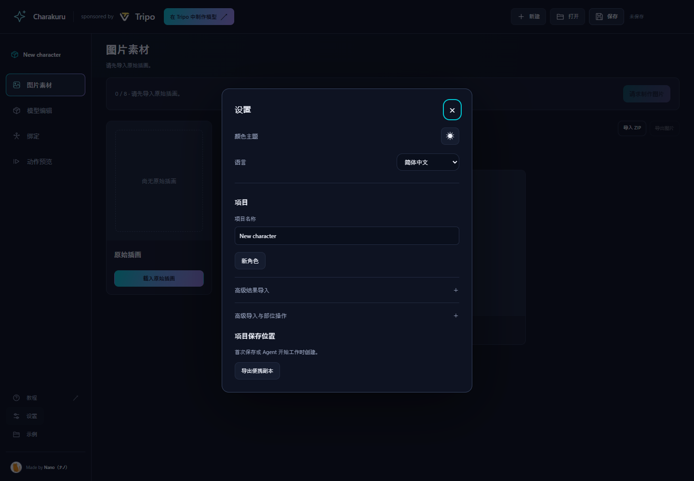
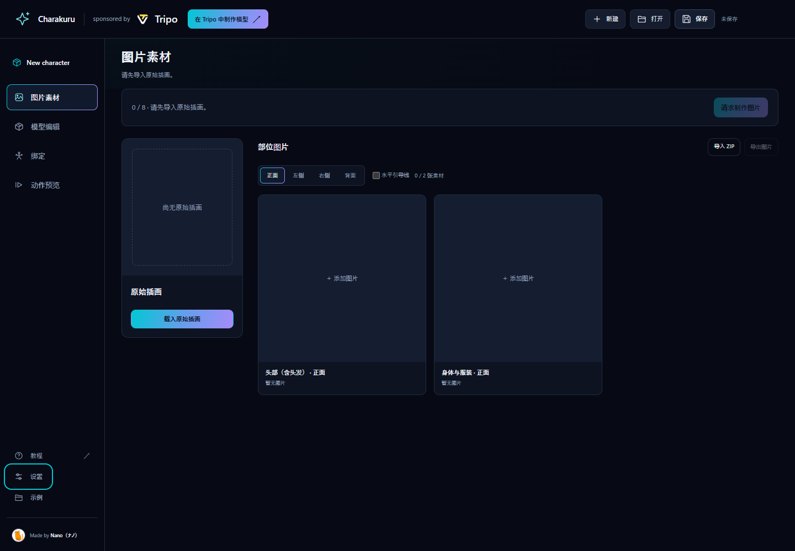

# Charakuru 使用教程

[English](tutorial.md) · [日本語](tutorial.ja.md) · [한국어](tutorial.ko.md) · [README](../README.zh-CN.md)

> 套件仍在开发中，文档由 AI 编写。遇到不清楚的地方，可让 Agent 阅读本教程并用简体中文说明。

您负责导入原图、确认图片、选择候选、调整比例和确认动作。Agent 负责中间的制作操作。通常不必自行操作 Blender，也无需每一步手动保存或重新附加项目。

## 1. 启动与语言

从 [Releases](https://github.com/nanocle/Charakuru/releases) 下载专用套件 ZIP，解压到可写文件夹。不要使用 GitHub 自动生成的 Source code ZIP 代替套件。在 Codex 中打开解压目录，发送：

```text
请阅读根目录 AGENTS.md，使用简体中文帮助我启动并制作角色。
```

Agent 检查 Node.js 22、图片生成、浏览器控制、Tripo 登录、Blender 5.2、Blender MCP 和 VRM Add-on。不足的环境会提示。启动后，在现有浏览器打开终端显示的地址，通常为 `http://127.0.0.1:8766`。自行启动时执行 `npm start`，无需 `npm install`。

在左下角**设置 → 语言**中选择 **简体中文**。语言会在当前浏览器保存。英语、日语、韩语与简体中文可随时切换，不会翻译或改写项目名称、素材名、提示词记录和用户备注。新复制的 Agent 请求、进度与结果应使用所选语言。



左侧依次为**图片素材 → 模型编辑 → 绑定 → 动作确认**。右上角有新建、打开和保存。



## 每一步如何发送请求

1. 点击当前阶段的继续或请求按钮。
2. 在弹窗点击**复制提示词**，粘贴到 Agent 聊天并发送。**只复制不会开始执行。**
3. 保持发出请求的应用标签页打开。Agent 首先执行 `agent-session.mjs begin`，保存当前最新状态；输出 `saved: true` 后才开始制作。
4. 工作进度会显示在页面标题下。完成后应用自动载入结果，并停在下一个确认点。

正常流程无需手动保存后再附加套件，也无需反复导入返回项目。浏览器使用规则见[浏览器与 Tripo](browser-use.zh-CN.md)。

## 2. 添加原始插画

在**图片素材**中点击载入原始插画，选择有权使用的全身角色图。支持 PNG / JPEG / WebP，最大 20 MB。替换原图不会自动替换之前生成的部位图。

点击**请求制作图片**并发送请求。Agent 以这张单张插画为设计依据，绘制：

- 含全部头发、无脖子的头部：正面、左侧、右侧、背面。
- 穿着服装、保留完整脖子的 T 姿势身体：正面、左侧、右侧、背面。

共八张部位图。头部采用平静、闭嘴的普通表情。完成后再根据原图和部位图制作调整比例用的全身正面、角色自身右侧面和背面三视图。

## 3. 确认八张图片与三视图

切换**正面 / 左侧 / 右侧 / 背面**，检查头发长度、轮廓、配饰、服装形状与颜色是否一致。左右以角色自身为准。

点击图片可放大和下载。若仅需修改某一张，点击**请求 Astra 修改**，复制请求到聊天，并补充具体位置和希望的改法。其他图片和模型不会因此自动修改。

同时检查下方比例参考三视图，确认原设计与头身比例。满意后点击**确认图片并继续**，复制并发送下一请求。

## 4. 比较并选择 3D 候选

Agent 在 Tripo 中用已采用的四方向图，为头部和身体各生成四个候选模型，采用 Smart Mesh P2.0、各 25,000 个四边面。**从这一阶段开始消耗 Tripo 积分。**

候选比较窗口会自动打开，可在模型编辑中通过**选择候选模型**重新打开。

1. 选择头部或身体，切换候选 1–4。
2. 拖动旋转，使用正面、右侧、左侧、背面、顶部、3D 查看；**线框**可检查网格密度。
3. 仅浏览不会选定候选。分别点击**选择此候选**，头部和身体都选择后再继续。

候选由您决定，Agent 只注册全部结果。

### 纹理完成后更换候选

应用会说明需要重做的内容。点击**创建副本并选择此候选**后，新项目重新进行部件、纹理、骨架和物理制作，原 .charakit、工作 Blend 与导出物保留。设置中的**打开原项目**可返回原分支。

## 5. 部件、UV 与纹理

Agent 会在 Tripo 分割候选，目视分类，并分别保存纹理分组与物理摆动分组。纹理采用五类：

| 分类 | 内容 |
| --- | --- |
| hair | 头发，不存在时省略 |
| head | 头部 |
| upper_body | 上半身 |
| lower_body | 腰部服装、裙子或裤子、腿、鞋组成的整个下半身 |
| accessories | 其他配饰，不存在时省略 |

小装饰跟随服装，大蝴蝶结即使连在衣服上，也可能单独作为配饰。裙子为摆动物理拆成独立网格时，纹理仍与腿和鞋共用一套穿着状态的下半身参考图，不能单独生成腿、鞋或裙子纹理。

随后 Agent 制作部位前后参考图，运行 Smart UV，为各组生成 **4K** 纹理，再把 UV 恢复到原部件并组装。保持纹理、UV、透明度，组装起应用 MToon。若相连的形状无法拆开，Agent 会展示具体位置并询问，请在聊天中回答。

## 6. 调整头身比例

在**模型编辑 → 位置与大小**中选择头部、头发或身体，调整大小与位置。切换正面和右侧检查头颈接缝、头部大小；↶ ↷ 可撤销和重做。

如需统一身高，输入**目标总高度（m）**并点击**应用高度**。总高度包含头发和配饰，示例 1.7 m 不是 VRM 要求。

### 调整参考三视图

参考图首次进入比例编辑时按模型高度与脚底对齐。点击**调整参考三视图**，对照半透明模型调整：

- 三张图共用角色高度和脚底高度，水平偏移独立。
- 缩放以脚底为基准；标尺跟随图片中的角色范围，排除透明边缘，不改变模型实际尺寸。
- 侧面使用角色自身右侧图，在右侧视图显示。
- 可添加、替换、拖动图片及调整透明度，锁定位置与大小会作用于全部三视图。
- **应用**保存；**取消**或 Esc 放弃本次调整。

满意后点击**确认比例并继续**，将请求发给 Agent。

## 7. 骨架、权重和摆动物理

Agent 将已摆放的头部与身体（不含头发）送到 Tripo 绑定，**仅读取骨骼位置**，不以返回模型覆盖原网格和纹理。随后拟合同捆基础模型并传递权重，为头发和服装设置摆动骨骼、权重和碰撞体。

从已保存 Blend 构建完成 VRM，并自动检查结构、MToon、纹理与每个部位的物理 ON/OFF 响应。外观好坏由您判断，不以 Agent 的外观评分或自动修正循环作为完成条件。

## 8. 确认动作并导出 VRM

**动作确认**会自动显示通过检查的 VRM，即使尚未填写模型信息，也默认播放行走并开启物理。

1. 从正面、侧面检查肩、肘、髋、膝和脚踝的变形。
2. 使用**默认（行走）**或**载入动作（VRMA）**切换动作，**更换**可替换已载入文件。
3. **暂停**只停止动画；可抓住模型移动，观察摆动物理。拖动背景操作相机。
4. **静止姿势**、**显示骨架**辅助检查。**重置物理**保留当前位置和姿势，仅初始化摆动。
5. 需要修正时，在聊天中说明具体问题。

载入的 VRMA 只在页面打开期间保留。重新载入后恢复默认行走。预览姿势、拖动位置和临时动作不会写入最终 VRM。

点击**导出 VRM**，确认模型名、作者、使用条件，再点**保存信息并导出**。信息随项目保存，供下次使用；形状、材质和物理与确认结果一致。取消表单仍可继续预览，无需再发送 Agent 请求。

本地应用同时保存 `exports/avatar.vrm` 与可编辑的 `exports/avatar.blend`。详见[动作确认指南](preview-user.zh-CN.md)。

## 保存、继续与迁移

- Agent 开始时自动保存应用最新状态；其他时间可点右上角**保存**。
- 同一文件夹再次启动会恢复上次项目；原图、图片、模型和制作状态在同一主文件中更新。
- 左侧可返回早期阶段，仅浏览不会撤销进度；改变图片、候选或位置后，相关后续阶段需重新执行。
- 跨电脑迁移请保留整个项目文件夹与 `exports`，不要只带走 `project.charakit`。设置中的**导出便携副本**可导出项目资料，但工作 Blend 和最终文件仍需保管。

## Windows 开始命令被拒绝

旧命令 `agent-session.mjs start URL REQUEST_ID` 曾被 Windows Codex 将 `start` 与 URL 误判为 URL 启动操作。新请求改用 **begin** 避开此误判，保存和输入检查条件不变。

1. 使用更新后的套件启动应用，确认要制作的原图或项目。
2. 重新复制请求并发送，确认开始命令使用 `begin`，保持应用打开。
3. Agent 确认命令成功并输出 `saved: true` 后才开始工作。请求失效或输入改变时，重新检查应用并复制请求，不必创建另一个项目。

若 `begin` 也在创建进程前因 `blocked by policy` 被拒绝，套件尚未执行。不要反复重试或绕过执行策略；报告套件、Windows、Codex 版本与权限设置，并移除错误中的个人路径。执行审批遵循当前工具规则。

## 常见问题

- **发送后没反应**：确认请求已粘贴到聊天并发送，应用标签页保持打开。
- **工作失败或停止**：查看页面显示原因；**重新载入已保存项目**可恢复保存状态。
- **Tripo 显示日语**：请求不再固定日语 URL。请在现有 Tripo 标签页选择简体中文；不可用时使用 English，Agent 仍用简体中文解释。见[浏览器说明](browser-use.zh-CN.md)。
- **浏览器阻止下载**：按 Agent 提示保存指定文件，无需重新制作全部阶段。
- **需要帮助或反馈**：使用[报告指南](../CONTRIBUTING.md)，不要附加私人项目或完整聊天。
